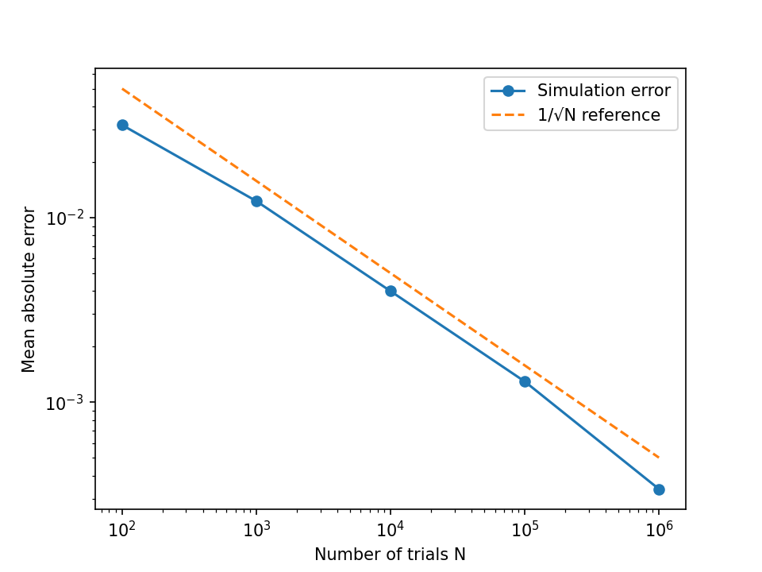

# Gambler's Ruin Monte Carlo Simulator

A vectorised Monte Carlo simulation of the gambler's ruin problem, validated
against the exact analytical solution.

## Problem
A gambler starts with 10 units and bets 1 unit at a time, winning with
probability 0.49. They stop on reaching 20 (success) or 0 (ruin). What is the
probability of ruin?

## Method
- Simulates 1,000,000 gamblers in parallel using NumPy arrays and boolean masks.
- Compares against the exact result (r^i - r^N) / (1 - r^N), where r = q/p.
- Repeats the simulation for N = 100 to 1,000,000 trials to measure how the
  error scales.

## Results
- Simulated ruin probability: 0.5990 (seed 7)
- Exact ruin probability: 0.5987
- Error shrinks as 1/√N, as shown in the graph below



## How to run
```
pip install -r ../requirements.txt
python gamblers_ruin.py
```