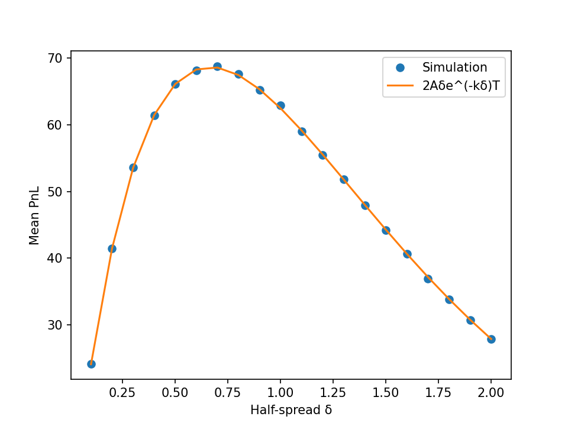
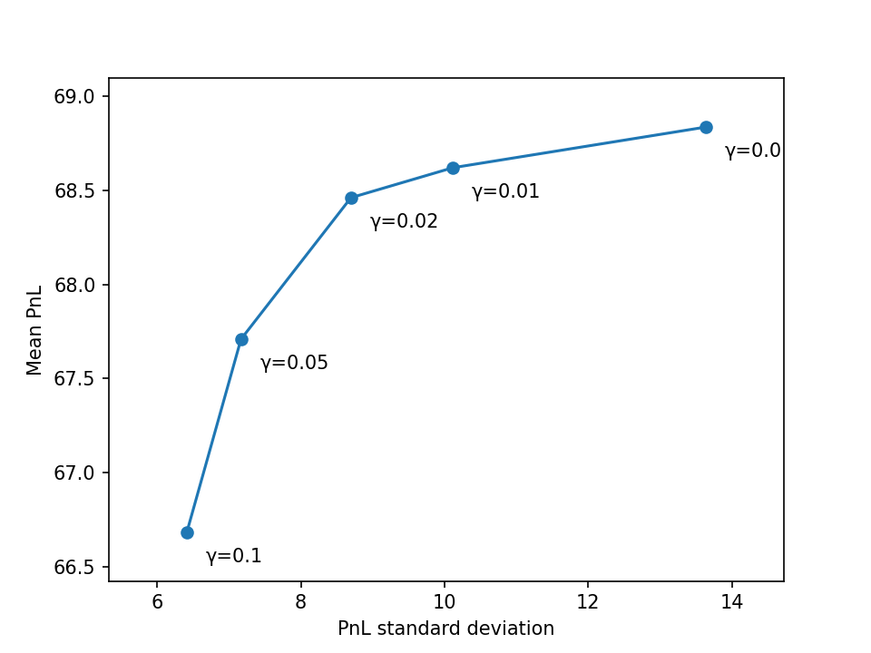

# Market Making Simulator

A vectorised Monte Carlo simulation of a market maker quoting around a random-walk
price, validated against a closed-form expected PnL and extended with
inventory-skewed quotes.

## Model
- Mid price follows a random walk: S(t+dt) = S(t) + σ√dt · Z, with Z ~ N(0, 1).
- The maker quotes a bid at S − δ and an ask at S + δ.
- Each side fills with probability A·e^(−kδ)·dt per time step, so wider spreads
  earn more per fill but fill less often.
- Final PnL = cash + inventory × final mid price.
- Parameters: S0 = 100, σ = 2, T = 1, dt = 0.005, A = 140, k = 1.5, seed 7,
  10,000 simulated paths.

## Theory
Expected fills per side over time T are A·e^(−kδ)·T, and each fill earns δ, so
expected PnL = 2Aδ·e^(−kδ)·T. Maximising δ·e^(−kδ) gives the optimal
half-spread δ* = 1/k.

## Results

**Validation against theory**
- Mean PnL at δ = 1/k: 68.49 simulated vs 68.67 theoretical.
- Across spreads from 0.1 to 2.0, the simulated PnL follows the theoretical curve.
- Best simulated spread: 0.70 vs theoretical 1/k = 0.67. The spread grid has
  step 0.1, so this comparison cannot resolve differences below about 5%.



**Inventory skew.** When long, the quotes shift so the maker is more likely to
sell, and the reverse when short. The skew strength is γ.

| γ    | Mean PnL | PnL std | Std reduction | Mean PnL cost |
|------|----------|---------|---------------|---------------|
| 0.00 | 68.84    | 13.64   | 0.6%          | -0.5%         |
| 0.01 | 68.62    | 10.11   | 26.3%         | -0.2%         |
| 0.02 | 68.46    | 8.70    | 36.6%         | 0.0%          |
| 0.05 | 67.71    | 7.17    | 47.8%         | 1.1%          |
| 0.10 | 66.68    | 6.41    | 53.3%         | 2.6%          |

Reductions and costs are measured against the baseline run (mean 68.49, std 13.72).
The γ = 0 row is a separate random draw, so small differences of around half a
percent are simulation noise.



## Limitations and next steps
- The price has no drift and the fill model is a simple exponential.
- Planned: a chi-squared goodness-of-fit test of the simulated PnL curve against
  the closed form, and a finer spread sweep around the optimum.

## How to run
From this folder:
```
pip install -r ../requirements.txt
python market_maker.py
```